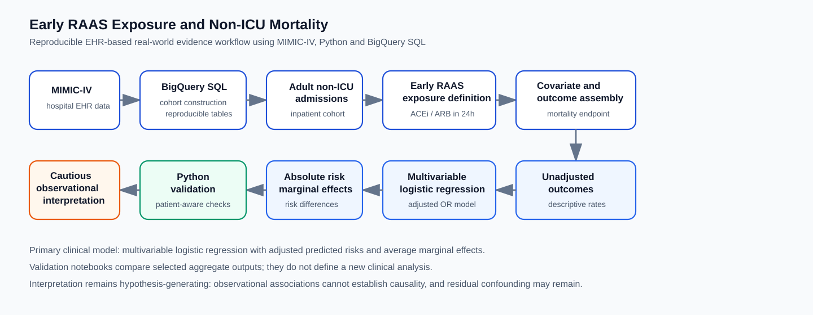
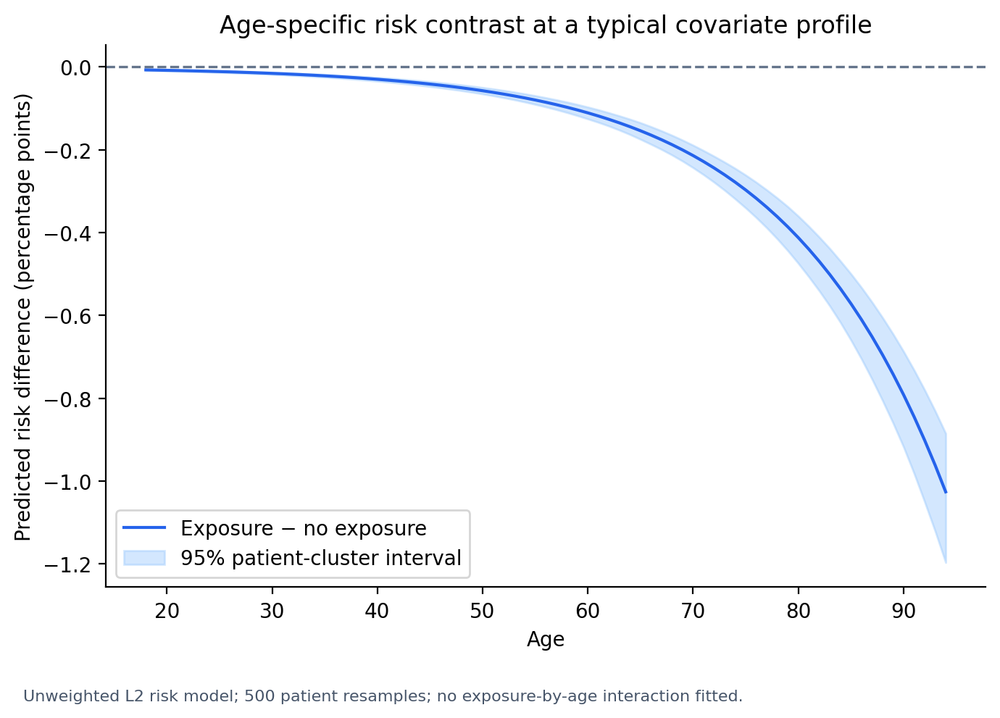

# Documented Early Inpatient RAAS Prescription Exposure and In-Hospital Mortality in Non-ICU Admissions

*A reproducible MIMIC-IV clinical analytics portfolio project*

Makoto Yoshida, PhD<br>
Clinical Data Analytics Portfolio<br>
LinkedIn: https://www.linkedin.com/in/makoto-yoshida/

## Overview

This repository presents an EHR-based retrospective cohort study using MIMIC-IV v3.1. It evaluates whether documented inpatient renin-angiotensin-aldosterone system (RAAS) prescription exposure within the first 24 hours of admission is associated with in-hospital mortality among adult non-ICU hospital admissions.

The primary clinical analysis is multivariable logistic regression with absolute risk estimation using average marginal effects. Findings are interpreted as hypothesis-generating associations, not causal effects.

The analytic unit is the hospital admission (`hadm_id`). The cohort is not restricted to one admission per patient, so a patient may contribute multiple qualifying admissions.

## Portfolio Report

For a portfolio-style clinical analytics report presenting the study background, methods, results, interpretation, limitations, and reproducibility workflow:

➡️ [View the Quarto HTML report](https://makotoy56.github.io/mimic-iv-nonicu-medication/reports/nonicu_raas_mortality_report.html)

This README provides the repository overview and technical navigation. The current [reproducible portfolio scope](docs/REPRODUCIBLE_SCOPE.md) covers BigQuery and Python notebooks 00–04c; 04c adds a separate prediction-time evaluation.

## Reviewer Path

For a quick review:

1. Read the Study Snapshot and Key Findings.
2. Review the representative figures, including the 24-hour landmark sensitivity analysis.
3. Open the Quarto report for methods, results, and interpretation.
4. Inspect the cohort-construction and modeling notebooks for implementation details.

## What This Demonstrates

- Real-world evidence workflow using hospital EHR data
- Reproducible cohort, exposure, covariate, and outcome construction in BigQuery SQL
- Transparent documented inpatient prescription-exposure definition using ACE inhibitor and ARB records with start times within 24 hours of admission
- Multivariable logistic regression with odds ratios, adjusted risks, and average marginal effects
- Numerical checks, patient-cluster uncertainty, and internal evaluation of retrospective discrimination
- Clear separation between clinical analysis, validation artifacts, and compliance-safe repository contents

## Workflow



The original association branch and additional 04c prediction branch use different cohorts and estimands. Firth provides supplementary ORs; a separate unweighted L2 model provides risks/AME. Prediction eligibility uses information through each prediction time and retains later ICU transfers.

For the detailed source-table-to-analysis-dataset lineage, see the [Quarto HTML report section on source tables and project-created analysis tables](https://makotoy56.github.io/mimic-iv-nonicu-medication/reports/nonicu_raas_mortality_report.html#source-tables-to-analysis-dataset).

## Why This Project Matters

This project shows how clinical analytics teams can move from raw EHR tables to an auditable real-world evidence workflow. It emphasizes transparent cohort, exposure, covariate, and outcome definitions; multivariable regression; and absolute risk interpretation for findings that need to be understandable beyond a purely statistical audience.

For clinical analytics, RWE, HEOR, and outcomes research teams, the portfolio value is the operational workflow: defensible data definitions, documented modeling choices, reproducible notebooks, and documented Python numerical checks. Limitations, including residual confounding and non-causal interpretation, are documented in the [discussion](docs/DISCUSSION_AND_LIMITATIONS.md).

## Key Findings

**Inference status:** Historical unpenalized primary/sensitivity fits have separation and remain nonconverged audit outputs. Supplementary Firth fits all converged. Current intervals below resample patients to account for repeated admissions; the original profile intervals are retained separately. Discrimination and absolute risks use separate L2 models.

- The analytic cohort included 460,786 adult non-ICU hospital admissions.
- Documented inpatient RAAS prescription exposure within 24 hours occurred in 56,825 admissions, or 12.33% of the cohort.
- Crude in-hospital mortality was lower among admissions with documented early RAAS prescription exposure than among admissions without it.
- The Firth sensitivity fit on the primary cohort returned OR 0.319 (95% patient-cluster CI 0.267–0.380). The original unpenalized primary output remains historical and nonconverged.
- The unweighted L2 risk model produced AME -0.3797 percentage points (95% patient-cluster CI -0.4201 to -0.3407).
- Age-specific predictions at a typical mean covariate profile showed larger absolute contrasts at older ages; no exposure-by-age interaction was fitted.
- The corrected 24-hour cohort contains 342,519 admissions and 1,769 deaths. Its Firth ordinary/proxy ORs were 0.356 (95% patient-cluster CI 0.292–0.423) and 0.382 (0.315–0.453); both fits converged.

**Reviewer interpretation:** The OR of approximately 0.32 and the model-predicted mortality difference are observational associations, not evidence that RAAS inhibitors caused lower mortality. Treatment eligibility, confounding by indication, early clinical stability, clinician prescribing behavior, and unmeasured clinical severity may affect the estimates. The landmark analyses address one timing-related bias concern but do not establish causality.

See [Results summary](docs/RESULTS_SUMMARY.md) and [Discussion and limitations](docs/DISCUSSION_AND_LIMITATIONS.md) for interpretation details.

## Results Visualizations

The README uses three figures to keep the result flow concise: observed outcome contrast, adjusted absolute-risk interpretation, and the 24-hour landmark sensitivity context. Technical validation remains in the reproducibility documentation rather than the main visual narrative.

### Crude Outcome Comparison

Observed in-hospital mortality was lower among admissions with documented early inpatient RAAS prescription exposure than among admissions without documented exposure.


### Adjusted Absolute Risk Interpretation

The unweighted L2 model contrasts exposure scenarios at a typical mean covariate profile. The intervals below resample entire patients; age-varying absolute contrasts are not a formal interaction test.



### 24-Hour Landmark Sensitivity Analysis

**Patient-aware update (2026-11-17):** Current uncertainty summaries use 500 prespecified patient-cluster bootstrap draws, carrying all eligible admissions per sampled patient. Firth point estimates and all exposure/cohort/adjustment definitions are unchanged. Historical admission-independent profile intervals remain available separately. See [patient-aware validation](docs/PATIENT_AWARE_VALIDATION.md).

The full-data Firth point fits passed convergence, rank, profile-bound and independent adjusted-score checks. The new figure uses patient-cluster percentile intervals; [original profile figure](assets/firth_landmark_sensitivity.png) and [Firth numerical validation](docs/FIRTH_SENSITIVITY_VALIDATION.md) remain available.

The corrected rule requires confirmed survival and continued hospitalization beyond 24 hours, removing 117,637 early live discharges plus separately counted inconsistent records. The figure below explicitly uses the supplementary Firth estimator. Historical nonconverged OR figures are excluded from the current public portfolio.


### Patient-Disjoint Retrospective Discrimination

The patient-disjoint holdout is an internal evaluation of retrospective discrimination on the full admission cohort. It uses prescription records from 0–<24 hours while including deaths within 24 hours, and applies no 24-hour survival/continued-hospitalization eligibility filter. There is no fixed clinical prediction time or prospective prediction horizon: ROC AUC 0.860635 and PR AUC 0.117607 do not describe admission-time or 24-hour prognostic performance. Patient separation and train-only preprocessing address patient overlap and preprocessing leakage, not temporal feature availability. The 24-hour landmark association analyses separately require confirmed survival and continued hospitalization strictly beyond 24 hours and evaluate subsequent in-hospital death; they use a different eligible cohort.

| Validation | Train / test admissions | Test deaths | Overlapping patients | ROC AUC | PR AUC |
| --- | ---: | ---: | ---: | ---: | ---: |
| Admission-random reference | 368,628 / 92,158 | 465 | 42,796 | 0.857576 | 0.106915 |
| Patient-disjoint holdout | 368,309 / 92,477 | 468 | 0 | 0.860635 | 0.117607 |

The retrospective holdout has zero train/test patient overlap. Scaling and categorical encoding are fitted on training data only. These are single splits with different case mixes, so their metric difference is not evidence of improved model performance. See [patient-aware validation](docs/PATIENT_AWARE_VALIDATION.md).

## Additional Prediction-Time Evaluation

This is an **additional** prediction-time analysis in notebook 04c, separate from 04b's original association cohorts and retrospective discrimination (ROC AUC 0.860635 / PR AUC 0.117607). The outcome is death strictly after the prediction instant through recorded hospital discharge, with a variable hospital-stay horizon.

At admission and at 24 hours, eligibility requires survival, continued hospitalization, a single confirmed non-ICU target-ward transfer interval, and no ICU entry up to that instant. General/specialty, intermediate/stepdown and hospital observation wards are included; ED/ED observation, PACU, nursery and unknown/ambiguous location are excluded. Later ICU transfers remain followed. No later ward entry backfills an unknown admission location. Admission-time results therefore apply to the ward-confirmed subset, not all admissions. This replaces neither the entire-stay ICU exclusion nor the numbers in the original association analyses.

The primary predictors are reconstructed age and recorded sex. A 24-hour companion adds a qualifying 0–<24h RAAS prescription record whose linked POE order time is no later than 24 hours; unverified or later order times cannot make the feature positive. This differs from the original association exposure. Records do not establish medication administration. Untimestamped demographics are assumed available at admission; original entry/version history is unavailable.

| Time | Eligible admissions / deaths | Train admissions | Test admissions / deaths | Later ICU admissions retained |
| --- | --- | --- | --- | --- |
| Admission | 719 / 11 | 556 | 163 / 3 | 258 |
| 24 hours | 336,372 / 3,457 | 268,731 | 67,641 / 698 | 15,329 |

| Model | ROC AUC (95% CI) | PR AUC / AP (95% CI) | Brier |
| --- | --- | --- | --- |
| Admission: age/sex | 0.548958 (CI withheld) | 0.030599 (CI withheld) | 0.018112 |
| 24h: age/sex | 0.686252 (0.668263–0.700923) | 0.021281 (0.018373–0.026761) | 0.010167 |
| 24h: age/sex + verified RAAS record | 0.699762 (0.681841–0.714670) | 0.022521 (0.019358–0.028395) | 0.010162 |

**Reading the admission-time calibration plot:** only 3 of the 163 test admissions died. Each point represents a group with similar predicted risks. One death can make a small group's observed rate jump by several percentage points; 0% means no deaths were observed in that group, not zero underlying risk. The jagged shape alone cannot establish model quality. Confidence intervals are withheld because too few patient resamples met the reporting rule; more deaths would need to be observed for reliable evaluation. See the [plot and plain-language guide](https://makotoy56.github.io/mimic-iv-nonicu-medication/reports/nonicu_raas_mortality_report.html#prediction-time-evaluation).

The protocol used unweighted L2 logistic regression (C=1, lbfgs, max_iter=2000), with training-only imputation, scaling and categorical encoding. One 80/20 patient allocation (seed 42) was fixed on the adult base before time-specific eligibility filters; all admissions of each patient stay in one partition. No test-driven tuning or recalibration was performed. Each model fit converged, with zero patient overlap. Each 24-hour model had 500/500 successful held-out-patient resamples. Admission had only 3 test deaths: 33/500 resamples had one outcome class, leaving 467/500 below the prespecified 95% threshold; all admission bootstrap intervals are withheld. Its point metrics/calibration are sparse-event diagnostics and do not establish reliable admission-time performance. Available 95% percentile intervals condition on the fitted training model and exclude training-sample uncertainty. Calibration is diagnosed without changing predictions. PR AUC is average precision (AP).

The admission and 24-hour populations differ. Metric differences across times are not evidence of improvement. The companion is a feature comparison, not a treatment-effect estimate. These limited-feature retrospective internal models are not prospective, external or deployment validation.

See the [protocol](docs/PREDICTION_TIME_PROTOCOL.md) and [real-data prediction validation](docs/PREDICTION_TIME_VALIDATION.md) for calibration, location uncertainty, exclusion counts and chronology sensitivity.

## Study Snapshot

| Area | Details |
| --- | --- |
| Data | MIMIC-IV v3.1 hospital admissions |
| Design | Retrospective observational cohort study |
| Population | Adult hospital admissions, including observation categories, excluding any ICU stay |
| Analytic unit | Hospital admission (`hadm_id`); patients may contribute multiple admissions |
| Exposure | Documented inpatient ACE inhibitor or ARB prescription with recorded start time from admission through less than 24 hours |
| Primary outcome | In-hospital mortality |
| Original primary model | Unpenalized multivariable logistic regression; nonconverged audit output |
| Supplementary OR estimator | Firth logistic regression; patient-cluster bootstrap intervals |
| Absolute risk estimand | Adjusted predicted risks and average marginal effects |
| Validation | Patient-cluster uncertainty and patient-disjoint holdout |
| Tools | BigQuery SQL, Python, Jupyter |

Exposure is based on inpatient prescription records. It does not confirm medication administration and does not directly capture outpatient chronic use, adherence, dose, treatment indication, or duration.

## Explore The Project

- [00 setup and source-access checks](notebooks/00_setup.ipynb)
- [01 cohort construction](notebooks/01_cohort.ipynb) and [short notes](docs/01_cohort_SHORT.md)
- [02 exposure definition](notebooks/02_exposure.ipynb) and [short notes](docs/02_exposure_SHORT.md)
- [03a input table validation](notebooks/03a_validate_input_tables.ipynb) and [short notes](docs/03a_validate_input_tables_SHORT.md)
- [03b analysis dataset description](notebooks/03b_describe_analysis_dataset.ipynb) and [short notes](docs/03b_describe_analysis_dataset_SHORT.md)
- [04a unadjusted outcomes](notebooks/04a_unadjusted_outcomes.ipynb) and [short notes](docs/04a_unadjusted_outcomes_SHORT.md)
- [04b multivariable outcomes](notebooks/04b_multivariable_outcomes.ipynb) and [short notes](docs/04b_multivariable_outcomes_SHORT.md)
- [04c additional prediction-time evaluation](notebooks/04c_prediction_time_evaluation.ipynb), [short notes](docs/04c_prediction_time_evaluation_SHORT.md), and [protocol/results](docs/PREDICTION_TIME_VALIDATION.md)
- [BigQuery SQL](sql/) and [infrastructure sanity check](scripts/validation_checklist.py)

## Detailed Documentation

- [Study background](docs/STUDY_BACKGROUND.md): RAAS biology, hospital medicine rationale, and prior literature
- [Methods overview](docs/METHODS_OVERVIEW.md): design, cohort, exposure, outcome, covariates, and modeling plan
- [Results summary](docs/RESULTS_SUMMARY.md): concise findings without causal strengthening
- [Discussion and limitations](docs/DISCUSSION_AND_LIMITATIONS.md): interpretation, residual confounding, and generalizability
- [Setup and reproducibility](docs/SETUP.md): Python environment, notebook execution expectations, and hygiene guidance
- [Reproducible scope](docs/REPRODUCIBLE_SCOPE.md): current BigQuery/Python workflow and validation boundaries
- [Figure reproducibility](docs/FIGURE_REPRODUCIBILITY.md): README figure export locations and refresh workflow

## Reproducibility And Validation

The workflow uses version-controlled notebooks, SQL scripts, and current aggregate Python outputs. No patient-level data are included in this repository. See [Setup and reproducibility](docs/SETUP.md) for the uv-managed Python environment and notebook hygiene workflow.

For complete environment and reproducibility details, see [REPRODUCIBILITY.md](REPRODUCIBILITY.md).

The [current real-data reexecution record](docs/CLINICAL_REEXECUTION_615de01.md) covers the original 00–04b workflow at `615de01` plus separate notebook 04c (8 notebooks, 93 code cells, zero runtime errors). Connected BigQuery checks and aggregate comparisons passed. Historical [8063e91 evidence](docs/PYTHON_WORKFLOW_VALIDATION.md) is preserved. Runtime success is separate from statistical convergence; the original unpenalized MLE remains nonconverged.

Validation scope:

- `04b_multivariable_outcomes.ipynb` contains the primary clinical analysis: multivariable logistic regression and absolute risk estimation.
- Python validation artifacts are stored under `python/outputs/`.
- `scripts/validation_checklist.py` checks aggregate row counts, exposure prevalence and repeat admissions, plus a static forbidden-feature guard; it does not establish model validity.

MIMIC-IV/PhysioNet access, Google Cloud authentication, BigQuery access, and local environment settings are configured outside the repository.

## Project Structure

```text
mimic-iv-nonicu-medication/
|-- assets/           # Portfolio visuals
|-- docs/             # Study background, methods, results, limitations, validation notes
|-- notebooks/        # Stepwise analysis and validation notebooks
|-- pyproject.toml    # uv project dependency metadata
|-- python/outputs/   # Aggregate Python validation CSVs
|-- scripts/          # Validation utilities
|-- sql/              # BigQuery SQL for cohort/exposure construction
|-- uv.lock           # uv-resolved dependency lockfile
`-- README.md
```

## Data Source And Compliance

This project uses MIMIC-IV v3.1, maintained by the MIT Laboratory for Computational Physiology and made available via PhysioNet.

Johnson A., Bulgarelli L., Pollard T., Gow B., Moody B., Horng S., Celi L.A., & Mark R. (2024). *MIMIC-IV (version 3.1)*. PhysioNet. RRID:SCR_007345. https://doi.org/10.13026/kpb9-mt58.

Access was granted after required training and approval under the PhysioNet data use agreement. This repository contains no patient-level data.
